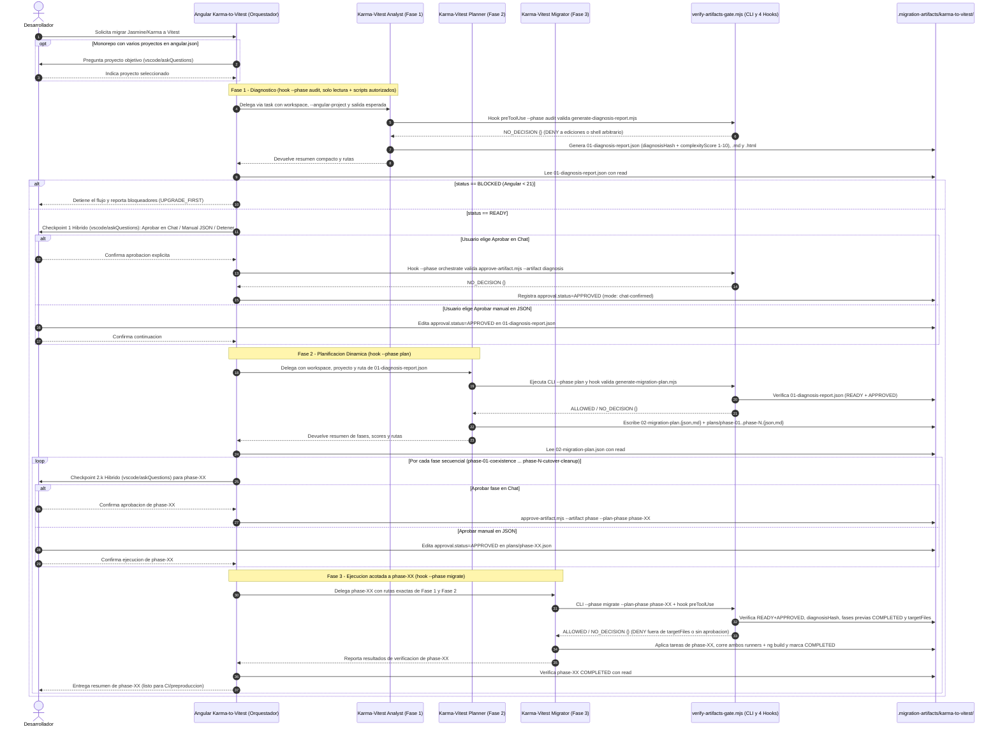

# Arquitectura del Orquestador (`Angular Karma-to-Vitest`)

Este documento describe mediante diagramas **Mermaid** el funcionamiento del agente orquestador ([karma-vitest-orchestrator.agent.md](../com.github.copilot/agents/karma-vitest-orchestrator.agent.md)), su delegación aislada a los 3 subagentes internos (`user-invocable: false`), la **aprobación humana híbrida** (`#vscode/askQuestions` + [approve-artifact.mjs](../skills/karma-vitest-migrate/scripts/approve-artifact.mjs) o edición manual en JSON), la **planificación incremental con convivencia Karma + Vitest** ([generate-migration-plan.mjs](../skills/karma-vitest-audit/scripts/generate-migration-plan.mjs)) y los 4 hooks agent-scoped `preToolUse` de [verify-artifacts-gate.mjs](../skills/karma-vitest-migrate/scripts/verify-artifacts-gate.mjs).

---

## 1. Diagrama de Flujo (Decisiones, Aprobación Híbrida y Bucle por Fases)

```mermaid
flowchart TD
    Start(["Desarrollador selecciona Angular Karma-to-Vitest\nHook preToolUse --phase orchestrate"]) --> MultiProj{"Multiples proyectos en angular.json sin especificar?"}
    MultiProj -- "Si" --> AskProj["Preguntar proyecto objetivo con vscode/askQuestions"]
    MultiProj -- "No" --> Phase1
    AskProj --> Phase1

    Phase1["Fase 1: Delegar a Karma-Vitest Analyst\nHook preToolUse --phase audit"]
    Phase1 --> RunDiag["Analyst ejecuta scripts/generate-diagnosis-report.mjs\nGenera 01-diagnosis-report.json, .md y .html\nIncluye diagnosisHash y complexityScore 1-10"]
    RunDiag --> ReadDiag["Orquestador verifica 01-diagnosis-report.json con read"]
    ReadDiag --> CheckStatus{"Estado del diagnostico?"}

    CheckStatus -- "BLOCKED / UPGRADE_FIRST\nAngular menor a 21" --> StopBlocked(["Flujo detenido: prohibido aprobar o invocar Planner/Migrator\nDerivar a upgrade de Angular 21+"])

    CheckStatus -- "READY / OFFICIAL_SCHEMATIC_SUFFICIENT" --> AskOfficial{"Usuario elige schematic oficial manual?"}
    AskOfficial -- "Si - Recomendado" --> EndOfficial(["Finalizar y ejecutar ng g @schematics/angular:refactor-jasmine-vitest"])
    AskOfficial -- "No - Quiere plan auditado" --> CP1

    CheckStatus -- "READY / HYBRID_SCHEMATIC_PLUS_AGENT" --> CP1["Checkpoint 1 - Aprobacion Humana Hibrida\nvscode/askQuestions o prompt CLI"]

    CP1 --> CP1Choice{"Decision del especialista"}
    CP1Choice -- "Aprobar en Chat" --> ApproveDiag["Orquestador ejecuta approve-artifact.mjs --artifact diagnosis"]
    CP1Choice -- "Aprobar manual en JSON" --> ManualDiag["Usuario edita approval.status=APPROVED en JSON"]
    CP1Choice -- "Rechazar / Detener" --> StopCP1(["Flujo detenido sin planificar"])
    ApproveDiag --> Phase2
    ManualDiag --> Phase2

    Phase2["Fase 2: Delegar a Karma-Vitest Planner\nHook preToolUse --phase plan"]
    Phase2 --> RunPlan["Planner ejecuta verify-artifacts-gate.mjs y generate-migration-plan.mjs\nParticiona 100% de specInventory por score y modulo"]
    RunPlan --> GenArt2["Escribe 02-migration-plan.json maestro\n+ plans/phase-01-coexistence ... plans/phase-N-cutover-cleanup"]
    GenArt2 --> ReadPlan["Orquestador lee 02-migration-plan.json con read"]

    ReadPlan --> NextPhase{"Queda alguna fase pendiente en plans/?"}
    NextPhase -- "No" --> Done(["Migracion completa: 100% Vitest + limpieza Karma"])
    NextPhase -- "Si: phase-XX" --> CP2["Checkpoint 2.k - Aprobacion Humana Hibrida de phase-XX\nMuestra targetFiles y verificationCommands"]

    CP2 --> CP2Choice{"Decision del especialista"}
    CP2Choice -- "Aprobar fase en Chat" --> ApprovePhase["Orquestador ejecuta approve-artifact.mjs --artifact phase --plan-phase phase-XX"]
    CP2Choice -- "Aprobar manual en JSON" --> ManualPhase["Usuario edita approval.status=APPROVED en plans/phase-XX.json"]
    CP2Choice -- "Pausar para CI / Preprod" --> PauseFlow(["Flujo pausado de forma segura hasta retomar"])
    ApprovePhase --> Phase3
    ManualPhase --> Phase3

    Phase3["Fase 3: Delegar UNA fase a Karma-Vitest Migrator\nHook preToolUse --phase migrate"]
    Phase3 --> HookMig{"Hook valida:\n1. Diagnostico READY+APPROVED y diagnosisHash\n2. Fases previas COMPLETED\n3. Fase activa APPROVED\n4. Ediciones dentro de targetFiles"}
    HookMig -- "Fallo o fuera de targetFiles" --> DenyMig["DENY incondicional\npermissionDecision: deny"]
    HookMig -- "Valido" --> ExecMig["Ejecuta tareas de phase-XX\nCorre ambos runners test + test-vitest + ng build\nMarca phase-XX COMPLETED"]
    ExecMig --> ReadPost["Orquestador verifica phase-XX COMPLETED con read\nConfirma validacion CI/Preprod"]
    ReadPost --> NextPhase
```

---

## 2. Diagrama de Secuencia (Interacción entre Agentes, Hooks y Artefactos)

